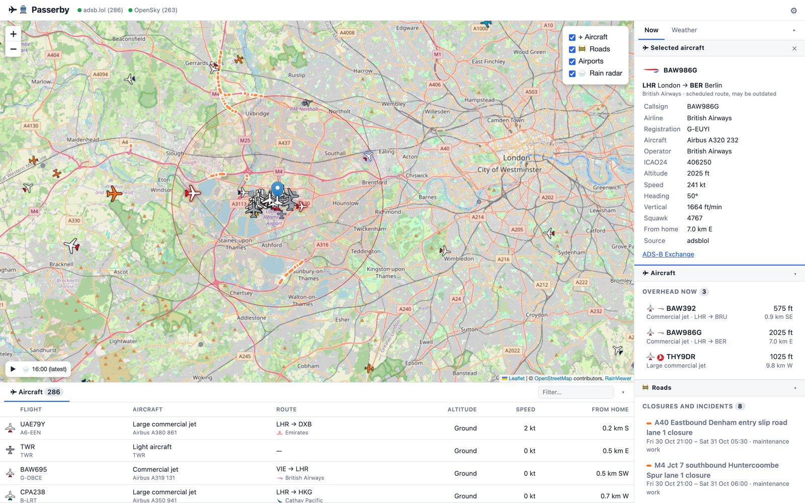
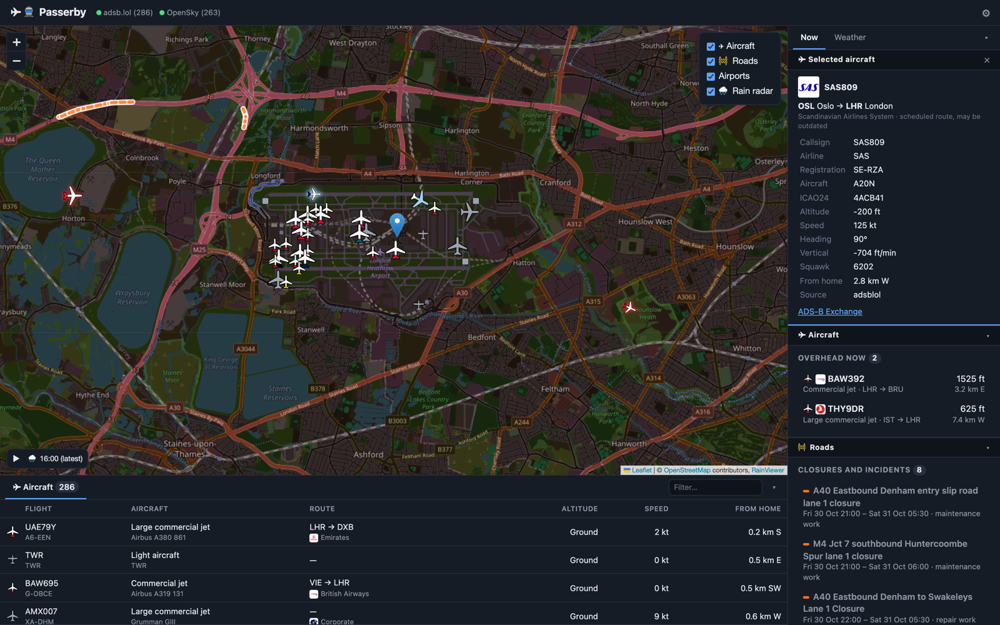

# Passerby

**Live planes, trains and buses passing your home.** A self-hosted web app that
shows aircraft (anywhere in the world), and trains, buses and road closures (UK),
around your home on a live map. It alerts you when something flies overhead or a
train is about to pass, and keeps a history of what it has seen.



<details>
<summary>Dark mode, zoomed in</summary>



</details>

- **Live map** (Leaflet + OpenStreetMap), pushed over a WebSocket every 2s.
  Each aircraft has an icon for its type: large or regular commercial jet, turboprop airliner, private jet,
  light aircraft, helicopter, military jet, glider, balloon, drone or ground vehicle. Airliners are drawn
  in their airline's colours, with the airline's logo alongside; everything else is coloured by altitude
  (or everything, if you prefer). Military aircraft are olive green, and aircraft not yet identified are
  see-through. Hovering over one shows its flight number, airline, origin → destination (airports and
  cities) and aircraft model.
- **Layout:** the map sits over a resizable drawer of tables (✈ Aircraft, 🚆 Trains and 🚌 Buses, with a filter).
  A side panel has three tabs: **Now** (grouped into ✈ Aircraft: overhead now; 🚆 Trains: passing home;
  🚌 Buses: near home; 📊 Today: counts), **Departures** and **Weather**.
  Click a group's heading to fold it away, or ▸ to hide the whole panel (◂ at the edge brings it back);
  both are remembered.
  Clicking an aircraft, train or bus (on the map, in the Now tab or in a table) centres the map on it
  and shows its details at the top of the side panel; ✕, Esc or clicking anywhere else clears it.
  Between updates, planes keep moving smoothly along their last known heading and speed (following
  their turn, if they're turning), then ease onto each new position.
- **Overhead alerts**: an in-page toast, plus a browser notification when served over HTTPS
- **Data sources**: [adsb.lol](https://adsb.lol) (unfiltered, including military), the [OpenSky Network](https://opensky-network.org), and/or your own ADS-B receiver (readsb/tar1090)
- **Aircraft details**: type, operator, and scheduled origin/destination from [adsbdb](https://www.adsbdb.com), plus a photo from [planespotters.net](https://www.planespotters.net)
- **UK trains** (optional): every train moving near you, freight included, live from [Network Rail's open data feeds](https://publicdatafeeds.networkrail.co.uk/ntrod/), with destinations, operators, calling points, departure boards, and alerts for trains passing your home
- **Buses** (optional, England): live positions from the DfT's [Bus Open Data Service](https://www.gov.uk/guidance/find-and-use-bus-open-data), shown when the map is zoomed in
- **Roads** (optional, England): closures and incidents on motorways and major A roads from National Highways
- **Rain radar** from [RainViewer](https://www.rainviewer.com)
- **Context**: nearby airports (OpenFlights) and METAR weather (aviationweather.gov)
- **History**: every sighting is logged to SQLite (`data/sightings.db`)

## Quick start (Docker)

Run this on any always-on machine: a Raspberry Pi 4/5, a NAS or an old PC.

Get `docker-compose.yml` and `.env.example` from this repository, then:

```sh
cp .env.example .env      # set HOME_LAT / HOME_LON, and ADMIN_PASSWORD
docker compose up -d
```

Open `http://<server-ip>:8000`. The image is `ghcr.io/ahammerton/passerby`
(amd64 and arm64): `latest` follows the main branch, and `0.1.0`, `0.1` and `0`
follow releases. To build it yourself instead, run this in a clone of the
repository before `docker compose up -d`:

```sh
docker build -f backend/Dockerfile -t ghcr.io/ahammerton/passerby:latest .
```

The default home is Heathrow Airport, so there's something to see straight
away: set your own location in `.env` or on the settings page.

### Settings page

Open **⚙** in the top corner of the map, or go to `/settings.html`, to change
these without editing files. The page has a tab for each area, and each tab
holds that service's login or API key. One **Save** at the bottom saves every
tab. A tab can be linked to directly, e.g. `/settings.html#buses`.
- **General:** display units (km, miles or nautical miles; feet or metres;
  knots, mph or km/h), backup & restore, and a note on the admin password.
- **Location:** home on a map (click it, drag the marker, or "Use my location"
  when the page is on HTTPS).
- **✈ Aircraft:** display radius, overhead alert radius and minimum altitude;
  your ADS-B receiver; the OpenSky API client (**Import credentials.json…**
  reads the file OpenSky gives you, in your browser, and fills in both fields;
  Save then checks it with OpenSky); the planespotters photo contact.
- **🚆 Trains:** train radius, departure boards, the "trains past home"
  stations, alert timing, and your Network Rail login.
- **🚌 Buses:** on/off, radius, zoom level, delays, disruptions, timetable
  region, and the BODS API key.
- **🚧 Roads:** on/off, radius, and the National Highways API key.

If a value is rejected when saving, its tab opens with the reason.

Saving applies the changes straight away by restarting the app's background
services (a second or two). Changing the location or train radius also
downloads track and timetable data for the new area, about a minute. Trains
reappear on the map as their next movement reports come in.

Changes are stored in `data/settings.json` and take priority over `.env`.
"Reset to .env defaults" removes them.

**How logins are handled:**
- **Write-only:** passwords and secrets are never sent back to the browser.
  The page only shows whether one is saved. Leave a box empty to keep the
  current value, type to replace it, or tick "Clear" to remove it.
- **Checked first:** a new Network Rail login or OpenSky client is tested
  against the service before it's saved, so a typo is rejected instead of
  breaking the feed.
- **Stored in plain text:** `data/settings.json` is readable only by its
  owner, but the logins in it aren't encrypted, just as in `.env`. Treat the
  `data/` folder (and its backups) as private.
- **Admin password:** set `ADMIN_PASSWORD` in `.env` and the settings page
  asks for it (once per browser, for 30 days) before showing or changing
  anything. The map itself stays open to everyone on the network. Without a
  password, anyone who can reach the app can change settings, including
  logins, though they still can't read them. The password can only be set in
  `.env`, so a mistake on the settings page can't lock you out.

### Backup & restore

At the bottom of the settings page:
- **Download backup** saves every setting on the page as a JSON file.
- **Include logins and API keys** adds the passwords and keys, in plain text.
  It's only available when `ADMIN_PASSWORD` is set, so nobody else on the
  network can download them.
- **Restore from file…** loads a backup back and applies it straight away.
  Values are checked first. A backup without logins keeps the current ones,
  and settings from a newer version are skipped, with a note.

### OpenSky credentials (recommended)

The quickest way is the settings page's **Import credentials.json…** button.
Otherwise, follow these steps for `.env`:

Without an account, the app polls OpenSky only every 4 minutes to stay within the
anonymous daily quota. To poll every 30 seconds:

1. Register at <https://opensky-network.org>.
2. On your account page, create an API client.
3. Put its ID and secret in `OPENSKY_CLIENT_ID` and `OPENSKY_CLIENT_SECRET`.

### Aircraft photos

Photos come from planespotters.net. Their API requires a way to contact you,
so set `CONTACT` in `.env` to your email or a URL. Until then, photos stay off.

### Community feeds

**adsb.lol** is on by default and is polled every 30 seconds (`ADSBLOL_INTERVAL`);
planes keep moving smoothly in between. It rate-limits each internet connection,
so run only one copy of the app per connection: two copies, or a shorter
interval, can get you temporarily blocked (HTTP 429). It reports
military aircraft too; these get a **MIL** badge.

**airplanes.live** uses the same data format, but its API now asks you to
email `contact@airplanes.live` describing your project first. Once they've
agreed, set `AIRPLANESLIVE_ENABLED=true`.

When several sources report the same aircraft, the freshest wins: your
receiver first, then the community feeds, then OpenSky.

### Routes

Routes come from adsbdb's database of scheduled flights, matched by callsign.
They can be out of date for airlines that reuse flight numbers, so the
details label them "scheduled".

Lookups run at one per second, nearest aircraft first, and are cached
(30 days for aircraft, 3 days for routes). Right after the first start, it
takes a few minutes before every aircraft has its details.

## UK trains

Trains come live from Network Rail's TRUST train movements feed, part of
[Network Rail Open Data](https://publicdatafeeds.networkrail.co.uk/ntrod/).
It covers every train on the network, including freight and non-stopping
services. There are no request limits.

1. Register at <https://publicdatafeeds.networkrail.co.uk/ntrod/create-account>
   (free; approval can take a while).
2. Set `NROD_USERNAME` (your email) and `NROD_PASSWORD` in `.env`.
3. Optionally, set `TRAIN_RADIUS_KM` (default 5).
4. Optionally, set `TRAIN_WATCH` to the two adjacent stations either side of your home, e.g.
   `TRAIN_WATCH=FEL,AFS` (Feltham and Ashford, Surrey).
5. Optionally, set `TRAIN_BOARDS` to the stations you want departure boards for, e.g.
   `TRAIN_BOARDS=FEL,HOU`. By default you get a board for the station nearest home. You can look station codes up at
   [nationalrail.co.uk](https://www.nationalrail.co.uk/stations/).

You get:
- **Every train nearby** on the map: 🚆 for passenger trains, 🚂 for freight
  and locomotives. Their details show the train's headcode and type, its last
  and next reporting points, its platform and whether it's running late.
- **Passing home** (Now tab, under 🚆 Trains): the trains actually about to
  pass your house. Only trains tracked live and due within
  the next few minutes are listed (5 by default), plus a hint of the next
  scheduled one. A toast or notification comes a minute before each passes.
  Switch it off, or change how far ahead it looks, under Settings → Trains
  (`PASSING_WINDOW`, `PASSING_MINUTES`).
  - `TRAIN_WATCH` picks the line. The spot on its track nearest your house is
    what counts, so trains that aren't timed at either watched station
    (expresses, freight) are included whenever their route runs past it.
    This works the same for any pair of neighbouring stations, anywhere.
  - If home isn't actually between the two chosen stations, or is more than
    2 km from that line, the settings page and the sidebar show a warning.
- **Timetable details** for each train: origin and destination, operator,
  train type, top speed, first class and catering, and the calling points
  with expected times based on its current delay.
- **Departure boards** for the next two hours, with platforms, live running
  for trains already on their way, and cancellations.
- **Station view:** click any station on the map (or a station name on the
  Departures tab) for a plan of its platforms and tracks from OpenStreetMap.
  - **Trains on the plan:** each train is a dot on its platform (hollow if
    arriving), and occupied platforms are highlighted.
  - **Alongside:** a platform-by-platform list (who's there, who's arriving,
    the next departure) and the station's departure board. It refreshes
    every 10 seconds.
  - **Which platform:** the one Network Rail reported the train at, if it's
    at this station; otherwise the timetabled one (marked "planned").
  - **Caching:** a station's layout is downloaded the first time you open it
    and cached for 30 days. Stations that aren't mapped in OpenStreetMap get
    just the lists.

**The timetable:** this comes from Network Rail's SCHEDULE feed, using the
same login.
- **Download:** the app downloads the full national timetable once (about
  140 MB, under a minute) and keeps only the trains that run through your
  area in the next two weeks (about 7 MB).
- **Updates:** after that it applies each night's update file (about 2 MB,
  published around 01:30). Every file is numbered; if one has been missed,
  the app downloads the full timetable again. It also does a full download
  weekly, to bring new dates into range.
- **Matching:** each live train is matched to its timetable entry through
  TRUST's activation message. A train that was already running when the app
  started is matched by its headcode, location and time instead.

**How positions work:** TRUST reports each train arriving at or departing
from timing points, plus the next timing point and how many minutes it should
take to get there. Only stations have coordinates, so the app:
- puts a train at a station when it arrives there;
- moves it **along the railway track** from the last station it reported at
  towards the next one, using the expected running time;
- treats reports at junctions in between as timing updates only.

**Railway lines:** the track around home (your train radius plus 10 km) is
downloaded once from OpenStreetMap through the Overpass API, then cached in
`data/railways.json` for 30 days. If the main Overpass server is busy, mirror
servers are tried. If all of them fail, the app retries in the background
(1 minute, doubling up to 30), and trains use straight lines until the track
arrives. The track is drawn as grey dashed lines, which you can turn
off with the "Railway lines" layer toggle. It also gives the route each train
follows between two stations. Where a stretch isn't in the track data (for
example, a next station far outside the area), the train falls back to a
straight line, and its details say so. "Approaching home" times use the
distance along the track too.

A train whose next report point is a junction disappears briefly after
leaving a station, then reappears once its next station is known.

**Train class:** taken from the timetable's "timing load", so it's the
*planned* class:
- **Diesel units:** decoded from letter codes. For example, T = Class 165/166
  (GWR Reading–Gatwick), X = Class 159 (SWR Waterloo–Exeter), V = Class
  220/221 (CrossCountry).
- **Electric units:** shown when the operator fills it in. South Western
  Railway leaves it blank, which covers about three-quarters of the trains
  around Guildford.
- **Freight:** shows the load hauled (e.g. 1,600 t) rather than a
  locomotive class.

The actual unit on each train isn't in Network Rail's open data. It needs
the Rail Data Marketplace's allocation and consist feed.

The app downloads CORPUS reference data (location codes to stations) with
your login on first start, caches it in `data/`, and refreshes it weekly.

Station locations come from
[uk-railway-stations](https://github.com/davwheat/uk-railway-stations)
(© David Wheatley, Trainline EU and contributors, ODbL). Railway lines ©
OpenStreetMap contributors (ODbL). Train data:
"Contains information of Network Rail Infrastructure Limited licensed under
the following licence" (the Network Rail data feeds licence).

## Buses (England)

Live bus positions from the Department for Transport's
[Bus Open Data Service](https://www.gov.uk/guidance/find-and-use-bus-open-data)
(BODS). Operators in England publish where every vehicle is, refreshed about
every 10 seconds.

1. Register free at [data.bus-data.dft.gov.uk](https://data.bus-data.dft.gov.uk/)
   and copy the API key from your account.
2. Enter it on the settings page's **🚌 Buses** tab, or set
   `BODS_API_KEY` in `.env`. It's checked with BODS before it's saved, and
   never shown again.

**On the map:**
- **Zoom-dependent:** buses only appear when you're zoomed in to the level
  set in Settings (default 12, a town and its surroundings) or closer. Zoomed further out,
  the layer list says "Buses · zoom in".
- **Badges:** each bus is a badge with 🚌, its route number and an arrow
  pointing the way it's heading, in its operator's colour. Buses glide to
  each new position.
- **Operators:** names (e.g. "Stagecoach", "Safeguard Coaches") come from
  BODS's timetable listings. Each is looked up once and saved in
  `data/bus_operators.json`, refreshed monthly.
- **Colours:** BODS has no colours, so big groups get their brand colour
  (Stagecoach blue, First purple, Arriva teal, National Express red and a
  few more). Every other operator gets its own colour from a palette, chosen
  to differ from the others and saved so it never changes.
- **Details:** click a bus for its destination, origin, operator code, vehicle
  number and how long ago it reported.
- **Area:** the app fetches buses within the bus radius of home (default
  10 km) every 15 seconds, and draws only those in view.
- **🚌 Buses tab** (in the drawer under the map, next to Aircraft and Trains):
  every bus within the radius, nearest first, with route, destination,
  operator, heading, when it last reported and distance from home. It works
  at any zoom, and the filter box searches it. Click a row to zoom in to
  that bus and show its details.
- **Now tab → 🚌 Buses:** buses within a mile of home (1.6 km when distances
  are in kilometres), nearest first, with route, destination, distance,
  heading and report age. Click one to zoom to it.

**Delays and next stops:** each bus is matched to its timetabled journey (by
operator, route, first stop and departure time), and its position along
that journey's stops gives its delay.
- **Details:** "+4m", "On time" or "2 min early"; the stop it's at; and the next
  five stops, with the timetabled time crossed out when it's running late.
- **Buses tab** gets *Next stop* and *Running* columns. The Now tab shows the
  delay too.
- **Not started:** a bus showing its next journey before it starts (often
  while still at the terminus) shows "Starts 17:36" instead of a delay.
- **Not shown:** a delay over 20 minutes is more likely a wrong match than
  real, so it's left out.
- **Data:** the timetables come from BODS's GTFS download for your region
  (picked from home, or set in Settings). It's about 300 MB, fetched weekly
  and cut down to the trips near home (`data/bus_timetable.json.gz`, about
  2 MB). Processing takes about a minute, in the background.
- **Route on the map:** selecting a bus draws the route it's running,
  with every stop marked (hover for its name and time; stops already passed
  are greyed out). Operators that publish the road path (Stagecoach and
  First around Guildford) get a line along the roads; for the rest the stops
  are joined in order, shown dashed. Clearing the selection removes it.
- **Match rate:** around 90% of buses near Guildford match. National Express
  coaches and buses without a scheduled departure don't.

**Disruptions:** diversions, stop closures, road closures and events from
BODS's disruptions feed (SIRI-SX), using the same API key, every 10 minutes.
- **Which:** what's on now or starts within a week, near home. A disruption
  that names its stops counts if one is within the bus radius. One that names
  no stops counts if at least half its routes run near home: route numbers
  repeat between towns.
- **Now tab → 🚌 Buses → Disruptions:** each with when ("Until Mon 2 Nov",
  "From Thu 6 Nov") and the routes affected. Click one for the full notice,
  with its stops marked ⚠ on the map.
- **Buses** on a route with a disruption on now carry a ⚠ on their badge, and
  their details link to it.

**Settings:** buses on/off, bus radius (1–30 km), the zoom level (10–18),
delays on/off, disruptions on/off and the timetable region.

**Notes:**
- Positions are what operators report. Some buses report only every 30–60
  seconds, and reports more than 5 minutes old are dropped.
- BODS takes the API key in the request URL. The app never logs that URL or
  shows it in status messages.

## Roads (England)

Closures and incidents on **motorways and major A-roads** from National
Highways. Council roads aren't covered: their roadworks data (Street Manager)
is only open to councils and utility companies.

**Setup:** register free at the
[National Highways developer portal](https://developer.data.nationalhighways.co.uk/),
subscribe to **Road & Lane Closures**, and enter the subscription key on the
settings page's **🚧 Roads** tab (or `NATIONAL_HIGHWAYS_API_KEY` in `.env`).

- **Roadworks** (planned closures): what's on now or coming up within a week,
  fetched every 15 minutes.
- **Incidents** (unplanned): closures set on the motorway signs, such as a
  lane closed after a crash, fetched every 2 minutes.
- **Map (🚧 Roads layer):** each closure drawn along the road: red for
  incidents, orange for roadworks, dashed until it's in force.
- **Now tab → 🚧 Roads:** incidents first, then what's on now, then what's
  coming ("Fri 30 Oct 21:00 – Sat 31 Oct 06:00"). Click one for its details;
  the map fits it in view.
- **Settings:** on/off and the road radius (default 15 km).
- **Limits:** the API allows 10 calls a minute per key; the app makes about
  one every two minutes.

## Rain radar

The **🌧 Rain radar** map layer shows the last two hours of radar from
[RainViewer](https://www.rainviewer.com/) (free, no key), every 10 minutes.
The player at the bottom left shows the frame's time; ▶ plays the two hours,
pausing on the latest. Untick the layer to hide it (remembered).
RainViewer's free images stop at zoom 7, so closer in they're enlarged: fine
for showing where the rain is, not street by street.

## Your own ADS-B receiver

If you already have a receiver on your network (a Flightradar24 or FlightAware
feeder, or a Pi running readsb/tar1090), the app can use it as its main source:
- Open **⚙ Settings → Your ADS-B receiver**, enter its IP address and press
  **Find receiver**. The app looks for its `aircraft.json` in the usual places
  (`/tar1090/`, `/skyaware/`, `/dump1090-fa/`, `/dump1090/`, `/data/`, `:8080`)
  and says how many aircraft it can see.
- Or set `READSB_ENABLED=true` and `READSB_URL=` in `.env`.

Both the newer readsb / dump1090-fa format and the older dump1090 one used by
Flightradar24's feeder are read. The receiver is polled every 2 seconds and
always wins for any aircraft it can see. **Online feeds** (`ONLINE_FEEDS`, or
the settings page) can either:
- **`fill`** (default): also show aircraft beyond your receiver's range. A
  single receiver typically positions only part of what's within 150 km.
- **`backup`**: stand by while your receiver is answering, and take over if
  it stops for 30 seconds. This also saves your adsb.lol and OpenSky quotas.

The app reads the receiver's decoded `aircraft.json` over HTTP. It doesn't use
the Beast (30005), BaseStation (30003) or raw (30002) ports.

### Building one

You need an RTL-SDR dongle with a 1090 MHz antenna, mounted as high as possible.

- **The receiver is already running elsewhere** (for example a Pi with readsb/tar1090):
  set `READSB_ENABLED=true` and point `READSB_URL` at its `aircraft.json`.
- **The dongle is plugged into this server:**
  ```sh
  docker compose --profile receiver up -d
  ```
  Set `READSB_ENABLED=true` and `READSB_URL=http://ultrafeeder/data/aircraft.json`.
  The tar1090 map is also available on port 8080.

## HTTPS on the LAN

Browsers only allow notifications and geolocation on HTTPS (or `localhost`).

- **Caddy:** set `SITE_ADDRESS` in `.env` and run `docker compose --profile https up -d`.
  Each device will warn about the certificate until you install Caddy's root
  certificate on it. Find it in the `caddy_data` volume at
  `pki/authorities/local/root.crt`.
- **Tailscale (simpler):** install it on the server and run
  `tailscale serve --bg 8000`. You get a valid HTTPS URL that works from your
  phone anywhere, with no router port forwarding.

With Caddy in front, set `APP_BIND=127.0.0.1` in `.env` so plain HTTP on
port 8000 is only reachable from the server itself.

If you browse to the app by a name that isn't an IP address or a local name
(`.local`, `.lan`, `.home.arpa`, `.internal`, `.ts.net`), add it to
`ALLOWED_HOSTS`. Other names are refused.

## Security

The app is built for a trusted home network.

- **Admin password** (`ADMIN_PASSWORD`) for the settings page and the receiver
  lookup. Sign-in uses a signed, HTTP-only cookie. After 10 wrong passwords
  in 5 minutes, that address is locked out for a while.
- **Host check:** requests must name an IP address, a local name or a host in
  `ALLOWED_HOSTS`. This stops DNS rebinding, where a web page you visit
  makes your browser talk to the app under the page's own name.
- **Same-site only:** changes and the live WebSocket feed are refused if they
  come from another website's page.
- **Browser hardening:** a content security policy (scripts only from the app
  and the pinned Leaflet release, checked by an integrity hash), no framing by
  other sites, no MIME sniffing.
- **Secrets:** logins are write-only on the settings page and stored
  owner-only in `data/settings.json`. The sign-in key is in `data/secret.key`.
  Treat `data/` and its backups as private.

**Don't port-forward this app to the internet.** The map and its data,
including your home location, need no login. Use Tailscale to reach it from
outside.

## API

| Endpoint | Description |
|---|---|
| `GET /api/aircraft` | Aircraft in range, nearest first |
| `GET /api/overhead` | Aircraft currently inside the alert radius |
| `GET /api/status` | Health of each data source |
| `GET /api/airports` | Nearby airports |
| `GET /api/weather` | Nearby METARs |
| `GET /api/photo/{icao24}` | Cached planespotters photo, or `null` |
| `GET /api/logo/{icao}` | Airline logo (PNG) by 3-letter ICAO airline code, or 404 |
| `GET /api/trains` | Trains near home with timetable details, departure boards and estimated passes |
| `GET /api/buses` | Buses within the bus radius, with feed status and nearby disruptions |
| `GET /api/buses/route?id=` | The route a bus is running: road path or stops joined, and every stop |
| `GET /api/radar` | Rain radar frames (RainViewer tile addresses) |
| `GET /api/roads` | Road closures and incidents near home (National Highways) |
| `GET /api/railways` | Railway track lines around home (OpenStreetMap) |
| `GET /api/station/{crs}` | One station: platform layout, trains there with platforms, departures |
| `GET/PUT/DELETE /api/settings` | Read, change (partial update) or reset the settings-page values (admin) |
| `GET /api/settings/backup?secrets=` | Download the settings as a backup file (admin; logins only with `ADMIN_PASSWORD` set) |
| `POST /api/settings/restore` | Restore a backup file (admin) |
| `POST /api/receiver` | Find a receiver's aircraft.json from an IP, host or URL (admin) |
| `GET /api/session`, `POST /api/login`, `POST /api/logout` | Admin sign-in when `ADMIN_PASSWORD` is set |
| `GET /api/stations?lat=&lon=&radius_km=` | Stations near a point |
| `GET /api/history?limit=100&overhead_only=true` | Logged sightings |
| `GET /api/stats` | Counts for the last 24h and 7 days |
| `WS /ws` | `snapshot` messages every 2s (with `trains` and `buses` when enabled), plus `alert` / `train_alert` messages |

## Development

```sh
cd backend
python3 -m venv .venv && .venv/bin/pip install -r requirements-dev.txt
.venv/bin/pytest
.venv/bin/uvicorn app.main:app --reload    # http://localhost:8000
```

Settings are read from environment variables or `backend/.env`. See `.env.example`.

### Layout

```
backend/app/
  main.py         FastAPI app, background pollers, WebSocket broadcast
  config.py       Settings (.env, overlaid by data/settings.json)
  user_settings.py  What the settings page may change, and validation
  aggregator.py   Merges sources, distance/bearing from home, overhead detection
  sources/        One class per aircraft feed (opensky.py, readsb.py, community.py)
  enrichment.py   adsbdb details and routes, planespotters photos, SQLite cache
  airlines.py     Airline from the callsign, its map colours, and logos
  trains/         Network Rail TRUST and SCHEDULE feeds, CORPUS, stations, OSM railway lines, positions, boards
  store.py        SQLite sighting history
  airports.py     OpenFlights airport data
  weather.py      METAR fetcher
frontend/         Static Leaflet UI (no build step): map (index.html) and settings.html
```

To add another feed (such as ADS-B Exchange), subclass
`AircraftSource` in `backend/app/sources/` and register it in `build_sources()`
in `main.py`.

## Ideas for next steps

- Highlight interesting aircraft (military, rare types, emergency squawks 7500/7600/7700)
- Send alerts to your phone via ntfy or Home Assistant
- Add a history page with charts built from `/api/history`

## Third-party data and services

Passerby only shows data from these services; it doesn't include or
redistribute it. Each has its own terms, and some need you to register:

| Data | From | Terms |
|---|---|---|
| Map tiles, railway lines | [OpenStreetMap](https://www.openstreetmap.org/copyright) contributors | ODbL; follow the [tile usage policy](https://operations.osmfoundation.org/policies/tiles/) |
| Aircraft positions | [adsb.lol](https://adsb.lol) | ODbL |
| Aircraft positions | [OpenSky Network](https://opensky-network.org) | Non-commercial use; see their [terms](https://opensky-network.org/about/terms-of-use) |
| Aircraft details and routes | [adsbdb](https://www.adsbdb.com) | Free API |
| Aircraft photos | [planespotters.net](https://www.planespotters.net) | Hotlinked with credit and a link back; set `CONTACT` to enable |
| Airline logos | [Jxck-S/airline-logos](https://github.com/Jxck-S/airline-logos) | Fetched on demand, never bundled; logos are the airlines' trademarks |
| Airports | [OpenFlights](https://openflights.org/data) | ODbL |
| Weather | [aviationweather.gov](https://aviationweather.gov) | Public domain (US government) |
| Rain radar | [RainViewer](https://www.rainviewer.com/api.html) | Free API, with attribution |
| Trains | [Network Rail open data feeds](https://publicdatafeeds.networkrail.co.uk/ntrod/) | "Contains information of Network Rail Infrastructure Limited licensed under the following licence" (the Network Rail data feeds licence) |
| Railway stations | [uk-railway-stations](https://github.com/davwheat/uk-railway-stations) | © David Wheatley, Trainline EU and contributors, ODbL |
| Buses | [Bus Open Data Service](https://www.gov.uk/guidance/find-and-use-bus-open-data) (DfT) | Open Government Licence |
| Roads | [National Highways](https://developer.data.nationalhighways.co.uk/) | Open Government Licence |

The airline colours are hand-picked approximations for a small map icon, not
official livery specifications.

## Licence

Passerby is licensed under the [Apache License 2.0](LICENSE).
Copyright 2026 Alan Hammerton.
